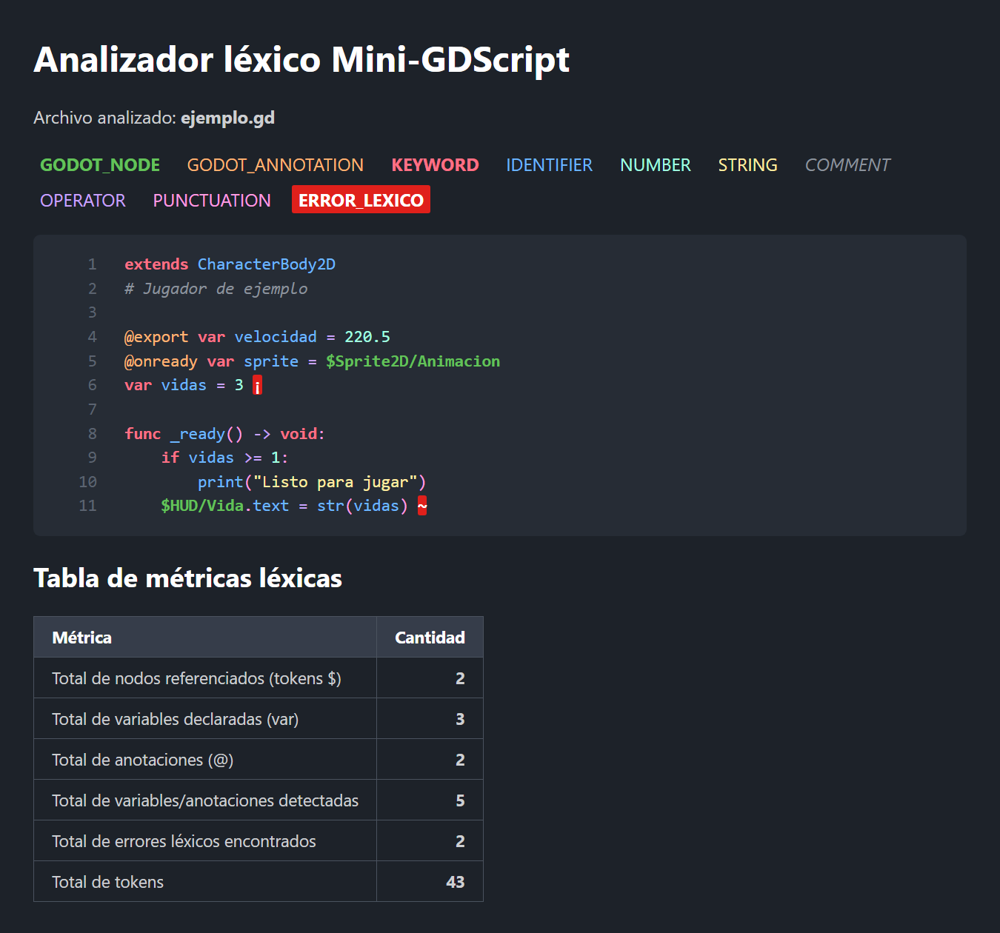
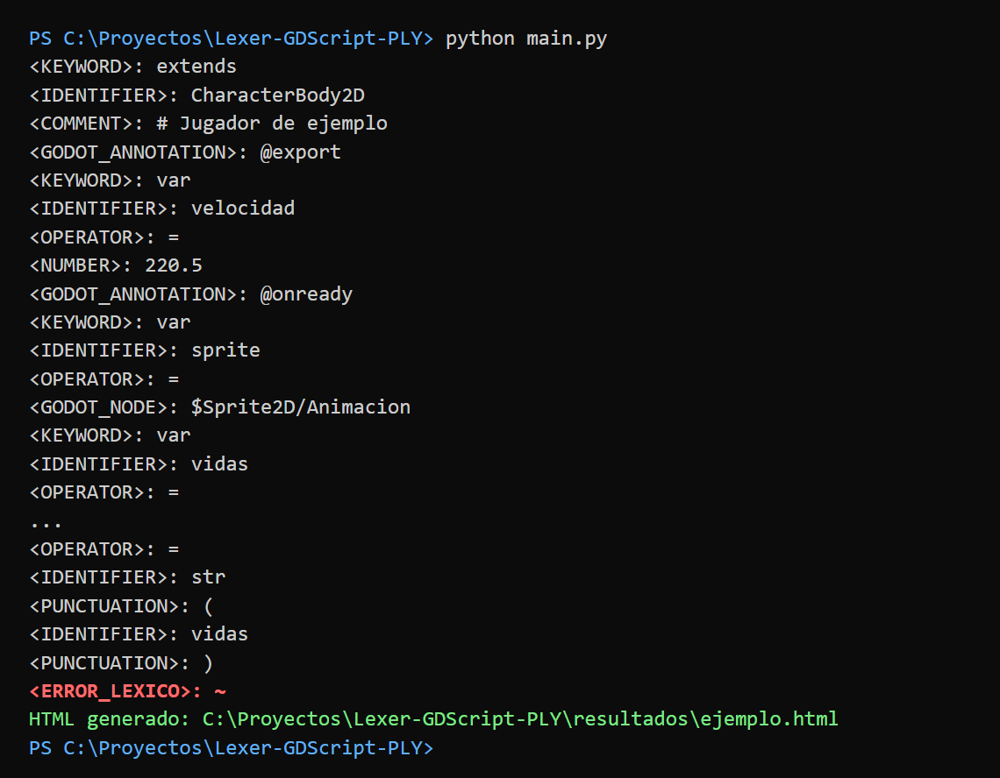
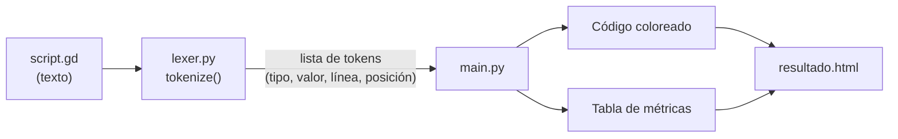

# Analizador léxico de Mini-GDScript con PLY

Resaltador de sintaxis y extractor de métricas para scripts de **GDScript** (el lenguaje del motor de videojuegos Godot), escrito en Python con la librería **PLY**.

Le das un archivo `.gd` y el programa:

1. lo separa en **tokens** (palabras clave, nombres, números, textos, nodos `$`, anotaciones `@`…),
2. genera una **página HTML** con el código coloreado según el tipo de cada token,
3. marca en **rojo** los caracteres que no pertenecen al lenguaje, sin detenerse,
4. agrega al final una **tabla de métricas** (nodos, variables, anotaciones y errores).



---

## Índice

- [¿Qué es un archivo `.gd`?](#qué-es-un-archivo-gd)
- [Requisitos](#requisitos)
- [Instalación](#instalación)
- [Uso paso a paso](#uso-paso-a-paso)
- [Ejemplo completo](#ejemplo-completo)
- [Cómo funciona](#cómo-funciona)
- [Mensajes de error](#mensajes-de-error)
- [Estructura del proyecto](#estructura-del-proyecto)
- [Limitaciones](#limitaciones)
- [Créditos](#créditos)

---

## ¿Qué es un archivo `.gd`?

Es un archivo de texto con código **GDScript**, el lenguaje que usa [Godot](https://godotengine.org/) para programar el comportamiento de los objetos de un juego (cómo se mueve un personaje, qué hace un enemigo, etc.). Se parece mucho a Python.

Este programa **no ejecuta** el `.gd` ni necesita Godot: solo lo lee como texto y lo analiza. Por eso sirve cualquier script de GDScript, incluso uno con errores.

> Este repositorio **no incluye** archivos `.gd`. Cada usuario pone los suyos en la carpeta `pruebas/` (ver [Uso paso a paso](#uso-paso-a-paso)). Si no tienes ninguno, copia el del [ejemplo completo](#ejemplo-completo).

---

## Requisitos

- **Python 3.8 o superior.** Para comprobarlo, abre una terminal y escribe `python --version`.
- **PLY 3.11**, que se instala en el paso siguiente.

---

## Instalación

1. Descarga el proyecto: botón verde **Code → Download ZIP** en GitHub (y descomprímelo), o clónalo:

   ```bash
   git clone <url-de-este-repositorio>
   cd Lexer-GDScript-PLY
   ```

2. Abre una terminal **dentro de la carpeta del proyecto** e instala PLY:

   ```bash
   pip install -r requirements.txt
   ```

   Si `pip` no funciona, prueba con `python -m pip install -r requirements.txt`.

---

## Uso paso a paso

### Opción A: analizar todos tus scripts de una vez

1. Copia tus archivos `.gd` dentro de la carpeta **`pruebas/`** del proyecto:

   ```
   Lexer-GDScript-PLY/
   ├── lexer.py
   ├── main.py
   └── pruebas/
       ├── jugador.gd      ← tus archivos
       └── enemigo.gd
   ```

2. Ejecuta, sin argumentos:

   ```bash
   python main.py
   ```

3. Se crea la carpeta **`resultados/`** con un HTML por cada `.gd` (`jugador.html`, `enemigo.html`…).
4. Abre cualquiera de esos HTML con doble clic: se ve en el navegador.

### Opción B: analizar un solo archivo, esté donde esté

```bash
python main.py ruta/al/script.gd
```

El HTML queda junto al `.gd`, con el mismo nombre (`script.html`). Si quieres otro nombre o carpeta, agrégalo como segundo argumento:

```bash
python main.py ruta/al/script.gd salida.html
```

En ambas opciones la terminal también muestra cada token encontrado, con el formato `<TIPO>: valor`.

---

## Ejemplo completo

Crea el archivo `pruebas/ejemplo.gd` con este contenido. Tiene dos errores puestos a propósito: el `¡` de la línea 6 y el `~` de la línea 11.

```gdscript
extends CharacterBody2D
# Jugador de ejemplo

@export var velocidad = 220.5
@onready var sprite = $Sprite2D/Animacion
var vidas = 3 ¡

func _ready() -> void:
	if vidas >= 1:
		print("Listo para jugar")
	$HUD/Vida.text = str(vidas) ~
```

Ejecuta `python main.py`. La terminal lista los tokens uno por uno; los errores léxicos aparecen como `<ERROR_LEXICO>` y el análisis **sigue hasta el final**:



Abre `resultados/ejemplo.html`. El código conserva sus líneas y sangrías, cada token tiene su color y los dos errores quedan con fondo rojo. Si pasas el mouse sobre un error, el navegador muestra en qué línea está:


La tabla de métricas de este ejemplo se lee así:

| Métrica | Valor | De dónde sale |
|---|---|---|
| Nodos referenciados (`$`) | 2 | `$Sprite2D/Animacion` y `$HUD/Vida` |
| Variables declaradas (`var`) | 3 | `velocidad`, `sprite` y `vidas` |
| Anotaciones (`@`) | 2 | `@export` y `@onready` |
| Variables y anotaciones | 5 | suma de las dos anteriores |
| Errores léxicos | 2 | `¡` y `~` |
| Tokens | 43 | todos los tokens del archivo |

---

## Cómo funciona



### 1. El lexer (`lexer.py`)

Usa `ply.lex`. Cada tipo de token se define con una **expresión regular**; PLY las junta en una sola y recorre el texto de izquierda a derecha. La función `tokenize(texto)` devuelve una lista de tuplas `(tipo, valor, línea, posición)`.

| Token | Qué reconoce | Ejemplo | Color en el HTML |
|---|---|---|---|
| `COMMENT` | `#` hasta el final de la línea | `# vida del jugador` | gris, cursiva |
| `STRING` | texto entre `"` o `'`, admite escapes como `\"` | `"Hola"` | amarillo |
| `GODOT_NODE` | `$` seguido de una ruta de nodos | `$Player/Sprite` | verde |
| `GODOT_ANNOTATION` | `@` seguido de un nombre | `@export`, `@onready` | naranja |
| `NUMBER` | enteros y decimales | `42`, `10.5` | verde agua |
| `KEYWORD` | palabras reservadas | `var`, `func`, `if`, `true` | rosado, negrita |
| `IDENTIFIER` | nombres de variables y funciones | `velocidad`, `_ready` | azul |
| `OPERATOR` | aritméticos, de comparación, lógicos y de asignación | `+`, `>=`, `->`, `+=`, `&&` | lila |
| `PUNCTUATION` | `: , . ( ) [ ] { }` | `(`, `:` | rosa claro |
| `ERROR_LEXICO` | cualquier carácter que no calza con nada | `¡`, `¿`, `~` | **blanco sobre rojo** |

Algunos detalles del diseño:

- **Palabras reservadas.** No tienen una regla propia: se reconoce la palabra completa como identificador y después se busca en una lista de 32 palabras reservadas. Así `format` no se parte en `for` + `mat`. La comparación distingue mayúsculas, por lo que `While` es un identificador y `while` una palabra reservada.
- **Orden de las alternativas.** PLY se queda con la primera alternativa que calza, no con la más larga. Por eso `==` va antes que `=` y los decimales antes que los enteros.
- **Errores que no detienen el programa.** Cuando ningún patrón calza, PLY llama a `t_error`, que convierte ese carácter en un token `ERROR_LEXICO` y avanza al siguiente. Dentro de un comentario o un texto entre comillas, símbolos como `¡` o `~` son válidos y no se marcan.

### 2. El generador de HTML (`main.py`)

- **Reconstruye el código original.** El lexer descarta espacios, tabulaciones y saltos de línea, así que `main.py` los recupera del texto original usando la posición de cada token. El HTML queda idéntico al `.gd`, carácter por carácter.
- **Colorea cada token** envolviéndolo en una etiqueta `<span>` con una clase CSS según su tipo.
- **Escapa** `<`, `>` y `&` para que el código no rompa la página.
- **Calcula las métricas** recorriendo la lista de tokens. Las variables se cuentan por cada `var`, así que no incluye parámetros de funciones ni variables de ciclos `for`.

---

## Mensajes de error

| Mensaje | Qué significa | Cómo arreglarlo |
|---|---|---|
| `Falta la librería PLY...` | PLY no está instalado | `pip install -r requirements.txt` |
| `Error: no existe la carpeta "pruebas"` | ejecutaste `python main.py` sin argumentos y no hay carpeta `pruebas/` | créala junto a `main.py` o usa la [opción B](#opción-b-analizar-un-solo-archivo-esté-donde-esté) |
| `Error: la carpeta "pruebas" no contiene archivos .gd.` | la carpeta existe pero está vacía | copia tus `.gd` en ella |
| `Error: no se encontró el archivo "..."` | la ruta que pasaste no existe | revisa el nombre y la ruta del archivo |

Si el HTML sale **sin código y con todo en 0**, el `.gd` está vacío. Revisa que lo hayas guardado (en VS Code, **Ctrl + S**).

---

## Estructura del proyecto

```
Lexer-GDScript-PLY/
├── lexer.py           # reglas del lexer (PLY) y función tokenize()
├── main.py            # genera el HTML y la tabla de métricas
├── requirements.txt   # dependencia: ply
├── pruebas/           # aquí van tus .gd (no se suben al repositorio)
├── resultados/        # se crea al ejecutar: un .html por cada .gd
└── docs/img/          # imágenes de este README
```

---

## Limitaciones

Es un analizador **léxico**: reconoce palabras y símbolos, pero no revisa si el programa tiene sentido. Por ejemplo, `func While = true` pasa sin errores, porque todos sus tokens son válidos aunque la línea no lo sea.

Además, el lexer no reconoce:

- rutas de nodo entre comillas (`$"Ruta con espacios"`) ni nodos únicos (`%Nombre`),
- números hexadecimales (`0xFF`) ni en notación científica (`1e3`),
- textos de varias líneas con triple comilla (`"""..."""`),
- nombres con letras fuera del inglés (`año`, por la `ñ`),
- la indentación como estructura de bloques (`INDENT`/`DEDENT`).

Según el caso, esos elementos se dividen en varios tokens (`0xFF` queda como `0` y `xFF`) o se marcan como error léxico (la `ñ` de `año`).

---

## Créditos

Taller I de **Fundamentos de la Computación**, Universidad Católica del Norte, 2026.

Autores: Ignacio Rojas, Henry Maquera y Santiago Sierra.
